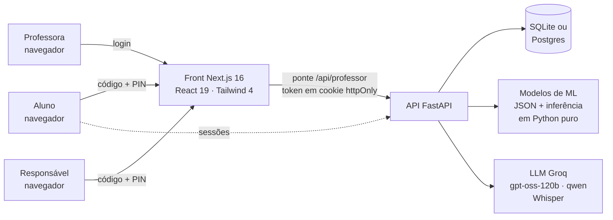

# Trilha

**Diagnóstico de aprendizagem com Machine Learning para professores do ensino fundamental (4º ao
9º ano), alinhado à BNCC.** O aluno pratica em trilhas curtas, no estilo de um jogo; a professora
vê, por habilidade, quem está bem, quem precisa de atenção e quem está em alerta. Ela também sabe
*por que* o modelo diz isso, quem pode piorar nas próximas semanas e como agrupar a turma para o
reforço.

Projeto final do Nanodegree em Inteligência Artificial e Machine Learning. Combina as duas
trilhas do enunciado: uma **solução de ML** que recebe dados e devolve previsões para orientar
decisões, e uma **aplicação com LLMs** (geração de exercícios com revisor, recomendações e
conversa sobre a turma).

## O problema

Numa turma de 30 alunos, a professora descobre quem não aprendeu uma habilidade só na prova,
quando já passou. Notas soltas escondem a trajetória: um aluno com média 70 pode estar subindo
ou desabando. E montar grupos de reforço cruzando uma planilha de habilidades leva tempo que
ela não tem.

## A solução

| Para quem | O que faz |
|---|---|
| **Aluno** | Entra com o código da turma e um PIN de 4 números. Faz trilhas de 6 perguntas por matéria, com dificuldade que se adapta sem ele perceber (2 acertos seguidos sobem o nível, 2 erros descem). Tem questões de completar a frase e de tocar no texto, e um botão para ouvir o enunciado. |
| **Professora** | Painel por turma com o status de cada aluno em cada habilidade (ok, atenção, alerta) e a explicação do modelo. Mostra quem pode cair para alerta, grupos de reforço sugeridos, conversa com IA sobre a turma, exercícios gerados por IA, relatório para a reunião com a família (PDF) e planilha da turma (CSV). |
| **Responsável** | Vê, só para leitura, o progresso do próprio filho (código da turma + PIN do aluno). |

São **921 questões** em 6 matérias (Português, Matemática, Geografia, Ciências, História e Inglês)
para 207 habilidades. As habilidades BNCC trazem o texto oficial do MEC
(`backend/app/bncc/oficial_ef.json`). Nenhuma questão entrega a resposta pelo tamanho da
alternativa, e a ordem das opções é sorteada (um teste automático garante as duas coisas).

## Arquitetura



- **Front** (`src/`): Next.js 16 (App Router, Server Components, Cache Components), modo claro e
  escuro, acessível (teclado, leitor de tela, contraste validado).
- **API** (`backend/app/`): FastAPI + SQLAlchemy. O banco é SQLite local (o padrão para
  apresentar, sem depender de rede), Postgres do Supabase, ou memória.
- **Modelos**: treinados com scikit-learn em `backend/ml/` e exportados para JSON. A API
  faz a inferência em Python puro, sem scikit-learn em produção, com previsões idênticas às do
  scikit-learn (um teste confere).
- **Segurança**: login do professor com senha em hash PBKDF2, token assinado e bloqueio após
  5 erros. Cada professor só enxerga as próprias turmas. Os PINs viram credenciais com validade,
  e os ids de sessão são aleatórios. A resposta certa nunca é enviada antes de o aluno
  responder. Há cabeçalhos de segurança e CSP.

## Machine Learning

Três modelos, cada um respondendo a uma pergunta da professora. As métricas são da última
execução e aparecem no app, na página **Diagnóstico**.

### 1. Diagnóstico: em que situação o aluno está nesta habilidade?

- **Dados**: 4.000 trajetórias de desempenho simuladas, cada uma com nível e tendência ocultos e
  ruído por dia. O rótulo vem do nível oculto, não de uma regra sobre as notas.
- **Features** (as mesmas no treino e na API): média, média recente, média inicial, tendência,
  oscilação, pior dia e dias de atividade.
- **Modelo**: Random Forest com 200 árvores. Hiperparâmetros escolhidos por GridSearch com
  validação cruzada estratificada de 5 partes, otimizando **F1 macro** (as três classes pesam
  igual).
- **Resultado no teste**:

  | Medida | Random Forest | Regra antiga (limiar na média recente) |
  |---|---|---|
  | F1 macro | **0,71** | 0,59 |
  | Acurácia | **75%** | 66% |
  | "Atenção" encontrados (recall) | **56%** | 30% |

  O ajuste quase dobrou o recall da classe "atenção" (de 29% para 56%), a mais difícil e a que
  mais ganha com ajuda cedo.
- **Explicável**: para cada habilidade, o painel mostra a probabilidade de cada status e os
  motivos em português ("vem piorando: −14 pontos", "oscila bastante").
- **Com dados reais**: a professora confirma ou corrige cada diagnóstico. Essas respostas viram
  rótulos reais: medem a concordância e entram no retreino (`ml/exportar_reais.py`). O modelo
  com dados reais só é implantado se não piorar na validação.

### 2. Previsão: quem pode cair para alerta?

Para habilidades que hoje **ainda não estão em alerta**, estima a chance de a média das
próximas 3 sessões ficar abaixo de 55. O modelo é um Random Forest balanceado, com ponto de
corte escolhido por validação cruzada (`ml/risco.py`).

| Medida (teste) | Modelo | Regra simples (tendência negativa e média < 70) |
|---|---|---|
| AUC ROC | **0,92** | — |
| Quedas avisadas antes (recall) | **73%** | 61% |
| Avisos que se confirmaram (precisão) | **49%** | 32% |

Quedas acontecem em só 11% dos casos, então metade dos avisos se confirmar fica bem acima do
acaso.

### 3. Grupos de reforço: quem tem dificuldades parecidas?

**k-means** (aprendizado não supervisionado) sobre a média recente de cada aluno em cada
habilidade. O número de grupos (2 a 4) é escolhido pelo coeficiente de silhueta, e cada grupo
vem com o foco: as habilidades em que ele fica abaixo da turma. É Python puro, validado contra o
scikit-learn (mesma silhueta). A página mostra a silhueta e explica o que ela significa: no
4º ano B ela é 0,22, ou seja, perfis próximos, e os grupos servem como ponto de partida.

## IA com LLMs (planos gratuitos)

| Onde | Como |
|---|---|
| **Exercícios de reforço** | O professor pede um exercício para uma habilidade e um nível. O gerador (`gpt-oss-120b`, Groq) cria a questão; um checador em Python confere o formato (4 opções distintas, sem opções equivalentes como 1/2 e 2/4, enunciado com pergunta); um **revisor de outro modelo** (`qwen3.8-27b`) resolve sem ver o gabarito e só aprova se chegar à mesma resposta, sem ambiguidade. Se algo falhar, entra uma questão do banco curado. |
| **Recomendações** | Texto pedagógico para cada habilidade em alerta ou atenção, com cache por habilidade e status para não gastar cota. |
| **Conversa sobre a turma** | O LLM recebe um retrato real da turma (alertas, evolução, quem sumiu) e responde à professora. |
| **Voz** | A professora pode perguntar por áudio (Whisper na Groq). |

**Avaliação do revisor** (`ml/avaliar_llm.py`, resultado na página Diagnóstico): na geração do
banco de questões, quando o próprio gerador revisava o que tinha feito, cerca de 30% das
aprovadas ainda tinham erro na conferência manual. Por isso o revisor passou a ser de outra
família de modelo. No teste controlado (20 questões curadas e as mesmas com o gabarito
trocado), os dois revisores pegaram 100% dos erros, porque gabarito trocado é um erro fácil.
Na geração ao vivo, o revisor de outro modelo foi mais rigoroso: aprovou 7 de 10, contra 8 do
próprio gerador. Medir os erros sutis exige conferir à mão uma amostra de questões geradas;
fica como próximo passo.

Sem chave de LLM, tudo continua funcionando com textos prontos e o banco curado.

## Como rodar

Requisitos: Node 24 e Python 3.12 ou mais novo.

**1. API** (pasta `backend/`)

```bash
cd backend
python -m venv .venv
# Windows: .venv\Scripts\activate    ·    Linux/Mac: source .venv/bin/activate
pip install -r requirements.txt
cp .env.example .env     # preencha o login do professor, TRILHA_SEGREDO e, se quiser, LLM_API_KEY
uvicorn app.main:app --reload
```

Com `DATABASE_URL=sqlite:///trilha.db`, a API cria e popula a demo sozinha na primeira vez.

**2. Front** (raiz do projeto)

```bash
npm install
echo "NEXT_PUBLIC_API_URL=http://127.0.0.1:8000" > .env.local
npm run dev
```

Abra <http://localhost:3000>:
- **Professora**: "Sou professor", com o e-mail e a senha do `backend/.env`.
- **Aluno**: código `SABIA4` (4º ano B, com histórico) ou `TUCANO8` (8º ano A, começando do
  zero). Os PINs aparecem em **Painel > Turma**.
- **Responsável**: o mesmo código da turma e o PIN do filho.

Sem `NEXT_PUBLIC_API_URL`, o front roda sozinho com dados de exemplo (login de exemplo
`professora@trilha.app` / `trilha-demo`, ou o que estiver em `PROFESSOR_SENHA`).

**Treinar os modelos de novo** (opcional): `pip install -r ml/requirements-treino.txt`, depois
`python -m ml.gerar_dados`, `python -m ml.treinar` e `python -m ml.risco`.

## Testes

```bash
npm test                # front: questões interativas (node --test)
npm run test:backend    # API: 55 testes (pytest)
```

Os testes do backend cobrem segurança (login, bloqueio, isolamento entre professores, CORS),
turmas e conteúdo por ano, qualidade do banco de questões, acesso do responsável e os modelos
(paridade com o scikit-learn, métricas acima da regra simples, k-means). A integração contínua
(`.github/workflows/testes.yml`) roda tudo a cada push, junto com typecheck e lint do front.

## Deploy

Planos gratuitos: front no Vercel, API no Render e, opcionalmente, Postgres no Supabase. O
passo a passo está em [`DEPLOY.md`](DEPLOY.md) (o `render.yaml` já configura a API).

## Limitações

- **Os modelos foram treinados com dados simulados.** Ainda não há anos de dados de alunos
  reais. O app já coleta os dados e os rótulos das professoras para medir e retreinar com o
  que for real, mas as métricas acima valem para trajetórias simuladas.
- **O conteúdo é um recorte de demonstração**: 4 habilidades BNCC por matéria do 5º ao 9º
  ano, com cerca de 20 questões por matéria. No 4º ano, Português tem o caminho BNCC completo,
  História tem um recorte, e Matemática, Geografia, Ciências e Inglês ainda usam o catálogo
  antigo, escrito à mão, sem código BNCC.
- **O status é um apoio à decisão, não uma nota.** A decisão pedagógica continua com quem
  conhece o aluno; por isso a professora pode corrigir o modelo.
- **A IA depende da cota gratuita da Groq.** Quando ela acaba, o app volta aos textos prontos.
- **Grupos de reforço** em turmas pequenas tendem a ter silhueta baixa; a página avisa quando
  for o caso.

## Estrutura

```
src/                 front (Next.js): app/, components/, lib/ (api, mock, regras do cliente)
backend/app/         API: rotas, repositório, regras, segurança, ML (inferência), LLM, BNCC
backend/app/bncc/    caminhos e questões por ano e matéria + texto oficial da BNCC
backend/ml/          treino e avaliação: diagnóstico, previsão de risco, avaliação do LLM
backend/tests/       testes da API
tests/               testes do front
```

Mais detalhes da API em [`backend/README.md`](backend/README.md).
