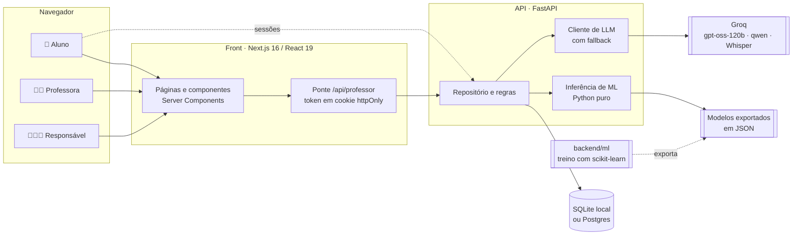

<div align="center">

# 🌱 Trilha

### Diagnóstico de aprendizagem com Machine Learning e IA para o ensino fundamental

**O aluno pratica em trilhas curtas, no estilo de um jogo. A professora descobre, habilidade por
habilidade, quem está bem, quem precisa de atenção e quem está em alerta, entende *por que* o
modelo diz isso e age antes da prova.**


-F55036)


*Projeto final do Nanodegree em Inteligência Artificial e Machine Learning*

</div>

---

## 📑 Sumário

- [O problema](#-o-problema)
- [A solução](#-a-solução)
- [Requisitos do projeto × o que foi entregue](#-requisitos-do-projeto--o-que-foi-entregue)
- [Funcionalidades](#-funcionalidades)
- [Conteúdo pedagógico (BNCC)](#-conteúdo-pedagógico-bncc)
- [Arquitetura](#-arquitetura)
- [Machine Learning](#-machine-learning)
- [IA com LLMs](#-ia-com-llms)
- [Segurança e privacidade](#-segurança-e-privacidade)
- [Design, acessibilidade e experiência](#-design-acessibilidade-e-experiência)
- [Tecnologias](#-tecnologias)
- [Como rodar](#-como-rodar)
- [Testes e integração contínua](#-testes-e-integração-contínua)
- [Deploy](#-deploy)
- [Estrutura do repositório](#-estrutura-do-repositório)
- [API: principais rotas](#-api-principais-rotas)
- [Decisões de projeto](#-decisões-de-projeto)
- [Limitações](#-limitações)
- [Próximos passos](#-próximos-passos)

---

## 🎯 O problema

Numa turma de 30 alunos, a professora só descobre quem não aprendeu uma habilidade **na prova**,
quando já passou a hora de ajudar. E as notas soltas enganam:

- **Uma média esconde a trajetória.** Um aluno com média 70 pode estar subindo ou desabando, e
  a ação certa é diferente em cada caso.
- **Não há tempo para cruzar planilhas.** Descobrir quais alunos têm a *mesma* dificuldade, para
  montar mesas de reforço, exige analisar dezenas de habilidades por aluno.
- **Falta material na hora certa.** Quando identifica a dificuldade, a professora ainda precisa
  preparar exercícios e explicar a situação para a família.

## 💡 A solução

A Trilha transforma a prática diária do aluno em **dados por habilidade da BNCC** e usa
**Machine Learning** para responder a três perguntas da professora:

| Pergunta | Técnica | Resposta no painel |
|---|---|---|
| **Como cada aluno está em cada habilidade?** | Classificação supervisionada (Random Forest) | Status *ok*, *atenção* ou *alerta*, com probabilidade e motivos |
| **Quem pode piorar nas próximas semanas?** | Previsão (Random Forest com ponto de corte calibrado) | "Pode cair para alerta" antes de o aluno travar |
| **Quem tem dificuldades parecidas?** | Aprendizado não supervisionado (k-means) | Grupos de reforço com o foco de cada um |

**LLMs** completam o ciclo: geram exercícios de reforço (conferidos por um revisor de outro
modelo), escrevem recomendações pedagógicas e conversam com a professora sobre a turma.

---

## ✅ Requisitos do projeto × o que foi entregue

O enunciado pedia **uma** de duas opções: uma solução de ML que recebe dados e devolve previsões
que orientam decisões, **ou** uma aplicação com modelos de linguagem. A Trilha entrega as duas,
integradas no mesmo produto.

| Requisito | Como a Trilha atende |
|---|---|
| **Ingerir dados** | Cada sessão do aluno vira histórico por habilidade (desempenho de 0 a 100 por dia). A professora confirma ou corrige o diagnóstico, e isso vira um **rótulo real**. |
| **Modelo que faz previsões** | Três modelos: diagnóstico (F1 macro **0,71**), previsão de risco (AUC **0,92**) e agrupamento (k-means com silhueta). |
| **Previsões que orientam decisões** | O painel mostra quem ajudar, em quê, quem pode piorar e como agrupar a turma, e explica o porquê de cada status. |
| **Aplicação com LLMs** | Geração de exercícios com revisor independente, recomendações, conversa sobre a turma e perguntas por voz (Whisper). |
| **Avaliação rigorosa** | Comparação com regra simples (*baseline*), validação cruzada estratificada, matriz de confusão, métricas por classe e avaliação do revisor de IA com erros plantados. |
| **Produto utilizável** | Aplicação web completa para três públicos (aluno, professora e responsável), com login, várias turmas e conteúdo do 4º ao 9º ano. |
| **Qualidade de engenharia** | 60 testes automatizados, integração contínua, modelo exportado com inferência em Python puro e guia de deploy em planos gratuitos. |

---

## ✨ Funcionalidades

### 🧒 Aluno
- Entra com o **código da turma** (ex.: `SABIA4`) e um **PIN de 4 números**, sem e-mail e sem
  senha para decorar.
- Escolhe a matéria e faz uma **trilha de 6 perguntas**, apresentadas como um caminho a percorrer.
- **Dificuldade adaptativa silenciosa:** dois acertos seguidos sobem o nível e dois erros descem.
  O aluno nunca vê o nível, para não se sentir rotulado.
- **Tipos de questão interativos:** múltipla escolha, **completar a frase** (a lacuna é preenchida
  na própria frase) e **tocar no texto** (o aluno toca a palavra certa num trecho).
- Botão **"Ouvir"**, que lê o enunciado em voz alta para quem ainda lê com dificuldade.
- Feedback imediato, estrelas e um mascote (o Sabiá) que reage aos acertos e erros.
- Segue um **caminho BNCC** em ordem: as próximas habilidades pendentes e uma revisão do que está
  em alerta.

### 👩‍🏫 Professora
- **Login seguro** e **várias turmas** por professora (4º ao 9º ano). No primeiro acesso, uma
  página guia a criação da primeira turma.
- **Painel da turma:** a matriz de alunos por habilidade, com filtros *Com alerta*,
  *Com atenção* e *Em risco*, ordenada pela gravidade.
- **Diagnóstico explicável:** para cada habilidade, a probabilidade de cada status e os motivos
  em português ("vem piorando: −14 pontos", "oscila bastante").
- **"O diagnóstico está certo?"** A professora confirma ou corrige o modelo, e a resposta vira
  dado para medir e retreinar.
- **Previsão de risco:** aviso de quem pode cair para alerta nas próximas sessões.
- **Grupos de reforço:** alunos agrupados por dificuldades parecidas, com o foco de cada grupo
  num gráfico que compara grupo e turma.
- **Página "Como o diagnóstico funciona":** métricas, matriz de confusão, importância dos
  indicadores, comparação de modelos e avaliação da IA.
- **Conversa com IA sobre a turma**, por texto ou por voz.
- **Exercícios de reforço gerados por IA** para qualquer habilidade e nível.
- **Relatório para reunião com a família**, em linguagem simples, com botão para imprimir ou
  salvar em PDF.
- **Planilha da turma** (CSV) que abre direto no Excel em português.
- **Gestão da turma:** ativar e desativar matérias e habilidades, cadastrar alunos e gerar novo
  PIN (o anterior para de valer na hora).
- Botão **"Reavaliar turma com o modelo"**, que roda o ML sobre o histórico de todos os alunos.

### 👨‍👩‍👧 Responsável
- Entra com o código da turma e o PIN do filho e vê **só o progresso dele**, apenas para leitura.
- Não tem acesso a nenhuma rota do professor nem a outros alunos.

---

## 📚 Conteúdo pedagógico (BNCC)

São **921 questões** e **6 matérias** (Português, Matemática, Geografia, Ciências, História e
Inglês), do **4º ao 9º ano**.

| Ano | Matérias | Habilidades | Questões |
|:---:|---|:---:|:---:|
| 4º | Português (caminho BNCC completo), História, Matemática, Geografia, Ciências e Inglês | 49 | 341 |
| 5º | Português, Matemática, Geografia, Ciências e História* | 20 | 100 |
| 6º | As seis matérias | 24 | 120 |
| 7º | As seis matérias | 24 | 120 |
| 8º | As seis matérias | 24 | 120 |
| 9º | As seis matérias | 24 | 120 |

<sub>* Na BNCC, Língua Inglesa começa no 6º ano; por isso o 5º tem cinco matérias.</sub>

**Cuidados com o conteúdo:**
- **Texto oficial da BNCC.** Cada habilidade usa o código e a descrição do documento do MEC
  (`backend/app/bncc/oficial_ef.json`), nunca uma paráfrase.
- **Questões escritas e revisadas à mão**, com 2 fáceis, 2 médias e 1 difícil por habilidade nos
  recortes de demonstração.
- **A resposta certa não se entrega.** Um teste automático garante que a alternativa correta não
  seja a mais longa (a taxa por arquivo fica perto do acaso, 25%). A ordem das opções é sorteada
  na carga e todo enunciado é uma pergunta completa. Esses cuidados nasceram de um teste manual
  em que dava para acertar "indo pela alternativa maior".

---

## 🏗 Arquitetura



**Como as partes conversam:**

- **Front (`src/`)**: Next.js 16 com App Router, Server Components e Cache Components. As telas
  do painel buscam dados no servidor. No navegador, as chamadas do professor passam por uma
  **ponte** (`/api/professor`), que anexa o token guardado num cookie httpOnly: o JavaScript da
  página nunca vê o token.
- **API (`backend/app/`)**: FastAPI e SQLAlchemy, com uma camada única de dados (`repo.py`) e
  regras puras e testáveis (`regras.py`).
- **Banco**: **SQLite em arquivo** (padrão para apresentar, sem depender da rede), Postgres do
  Supabase (para produção) ou memória (para testes). Num banco que já existia, a API acrescenta
  sozinha o catálogo novo ao subir, sem apagar turmas.
- **Modelos**: treinados offline com scikit-learn (`backend/ml/`) e exportados para JSON. A API
  faz a inferência **em Python puro**, sem scikit-learn em produção, com resultado idêntico ao do
  scikit-learn (verificado por teste).
- **Modo demonstração**: sem `NEXT_PUBLIC_API_URL`, o front roda sozinho com dados de exemplo,
  várias turmas e as mesmas regras de login, para desenvolver a interface ou demonstrar sem a API.

---

## 🤖 Machine Learning

> Todas as métricas abaixo são da última execução do treino. A própria aplicação as mostra na
> página **Diagnóstico** (`/painel/modelo`).

### Como os dados viram features

Cada aluno, em cada habilidade, tem uma série diária de desempenho (0 a 100). Dela saem **sete
indicadores**, calculados pelo mesmo código no treino e na API (`diag_features.py`):

| Indicador | O que mede |
|---|---|
| Média recente | Média dos últimos 3 dias com atividade |
| Média geral | Média de todos os dias |
| Média inicial | Média dos primeiros dias |
| Tendência | Se está subindo ou caindo, e quanto |
| Oscilação | Quanto varia de um dia para o outro |
| Pior dia | O menor desempenho registrado |
| Dias com atividade | Quanto histórico existe |

### 1️⃣ Diagnóstico: em que situação o aluno está nesta habilidade?

**Dados.** 4.000 trajetórias simuladas (3.000 para treino e 1.000 para teste). Cada trajetória
tem nível de proficiência e tendência **ocultos** e ruído por dia. O rótulo vem do nível oculto,
**não de uma regra sobre as notas**; assim o modelo precisa aprender a enxergar através do ruído.

**Modelo.** Random Forest com 200 árvores. Os hiperparâmetros vêm de uma **GridSearch** com
**validação cruzada estratificada de 5 partes**, otimizando **F1 macro**, para que a classe
menor ("atenção") pese tanto quanto as outras. Configuração escolhida:
`max_depth=8`, `min_samples_leaf=5`, `class_weight="balanced_subsample"`.

**Comparação de modelos (conjunto de teste):**

| Modelo | F1 macro | Acurácia | Recall de "atenção" |
|---|:---:|:---:|:---:|
| Regra de limiar (antiga: média recente ≥ 70 = ok, ≥ 55 = atenção) | 0,59 | 66% | 30% |
| Árvore de decisão | 0,67 | 75% | 33% |
| Random Forest, primeira versão | 0,67 | 76% | 29% |
| **Random Forest ajustado (em uso)** | **0,71** | **75%** | **56%** |

**Por classe (modelo em uso):**

| Classe | Precisão | Recall | F1 |
|---|:---:|:---:|:---:|
| Alerta | 0,89 | 0,82 | 0,85 |
| Ok | 0,83 | 0,77 | 0,80 |
| Atenção | 0,42 | 0,56 | 0,48 |

O ajuste **quase dobrou o recall da classe "atenção"** (de 29% para 56%). Essa é a classe mais
difícil, por ficar entre as outras duas, e a que mais ganha com ajuda cedo. As confusões
acontecem quase só entre classes vizinhas; o modelo praticamente não troca "ok" por "alerta".
A validação cruzada (0,716) confirma o F1 do teste (0,710).

**O que o modelo mais considera** (importância das features): média recente (27%) e tendência
(25%) quase empatam, seguidas de média geral (18%) e pior dia (12%). A tendência é justamente o
que a regra antiga não enxergava.

**Explicável.** Para cada habilidade, o painel mostra a probabilidade de cada status (voto médio
das árvores) e os motivos em português, gerados a partir dos indicadores.

**O ciclo com dados reais.** Como ainda não existem anos de dados de alunos, a Trilha traz um
caminho para incorporar a realidade:
1. a professora confirma ou corrige cada diagnóstico (*human-in-the-loop*);
2. a página do modelo mostra a **concordância ao vivo** entre o modelo e as professoras;
3. `ml/exportar_reais.py` exporta os casos rotulados e `ml/treinar.py` retreina misturando dados
   simulados e reais (com peso maior para os reais);
4. **trava de segurança:** o modelo com dados reais só é implantado se não piorar na validação
   cruzada feita só sobre os casos reais.

### 2️⃣ Previsão: quem pode cair para alerta?

O diagnóstico olha para **o presente**; este modelo olha **para a frente**. Para habilidades que
**hoje ainda não estão em alerta**, ele estima a chance de a média das **próximas 3 sessões**
ficar abaixo de 55.

- **Dados:** 5.000 trajetórias simuladas mais longas, cortadas em *passado* (o que o modelo vê) e
  *futuro* (de onde sai o rótulo).
- **Recorte honesto:** o treino considera só quem ainda não está em alerta. Incluir quem já está
  mal inflava a AUC para 0,97, com casos óbvios que não ajudam ninguém.
- **Modelo:** Random Forest com classes balanceadas e GridSearch otimizando AUC ROC. O **ponto de
  corte (0,72)** foi escolhido por validação cruzada, maximizando F1, em vez do 0,5 padrão.

| Medida (teste) | Modelo | Regra simples (tendência negativa e média < 70) |
|---|:---:|:---:|
| AUC ROC | **0,92** | — |
| Quedas avisadas antes (recall) | **73%** | 61% |
| Avisos que se confirmaram (precisão) | **49%** | 32% |

Quedas acontecem em só **11%** dos casos; metade dos avisos se confirmar fica bem acima do acaso.

### 3️⃣ Grupos de reforço: quem tem dificuldades parecidas?

Aqui não há rótulo, então o problema é de **aprendizado não supervisionado**.

- Cada aluno vira um vetor com a média recente em cada habilidade praticada pela turma. Onde o
  aluno ainda não praticou, entra a média da turma, para não puxá-lo para nenhum grupo.
- **k-means** com inicialização k-means++ e semente fixa (resultado reproduzível).
- O número de grupos (2 a 4) é escolhido pelo **coeficiente de silhueta**.
- O foco de cada grupo são as habilidades em que ele fica bem abaixo da média da turma.
- A implementação é em Python puro e foi **validada contra o scikit-learn**: mesma silhueta e
  índice de Rand ajustado de 1,0 ao recuperar perfis conhecidos.
- **A tela é honesta com a professora:** no 4º ano B a silhueta é 0,22 (perfis próximos), e a
  página avisa que os grupos são um ponto de partida, não uma regra.

### Do notebook à produção

```
backend/ml/gerar_dados.py ──► dados_sinteticos.csv ──► backend/ml/treinar.py ──► app/modelo_diagnostico.json
                                                       backend/ml/risco.py    ──► app/modelo_risco.json
                                                                                     │
                       app/diagnostico.py · app/risco.py (inferência em Python puro) ◄┘
```

O JSON do diagnóstico caiu de 4,2 MB para 1,4 MB com o ajuste. A **paridade com o scikit-learn é
de 100%** (teste automático com 800 amostras). Sem o arquivo do modelo, a API cai na regra de
limiar e nada quebra.

---

## 🧠 IA com LLMs

Tudo roda no **plano gratuito da Groq**, com provedor de reserva opcional (Gemini).

| Recurso | Como funciona |
|---|---|
| **Exercícios de reforço** | O professor escolhe habilidade e nível. O **gerador** (`openai/gpt-oss-120b`) cria a questão no mesmo formato do banco curado. Um **checador em Python** confere o formato (exatamente 4 opções distintas, sem opções equivalentes como 1/2 e 2/4, enunciado com pergunta). Um **revisor de outro modelo** (`qwen/qwen3.8-27b`) resolve a questão **sem ver o gabarito** e só aprova se chegar à mesma resposta, sem ambiguidade e sem erro de conteúdo. Se algo falhar, entra uma questão do banco curado. |
| **Recomendações pedagógicas** | Texto de orientação para cada habilidade em alerta ou atenção, com cache por habilidade e status para não gastar cota à toa. |
| **Conversa sobre a turma** | O LLM recebe um retrato real da turma (quem está em alerta, quem evoluiu, quem parou de praticar) e responde à professora em linguagem natural. |
| **Perguntas por voz** | A professora grava a pergunta e o Whisper (Groq) transcreve. |

**Funciona com ou sem IA.** Sem chave, ou quando a cota acaba, tudo volta aos textos prontos e
ao banco curado. A demonstração nunca quebra por causa do LLM.

### Avaliação do revisor (`ml/avaliar_llm.py`)

Na geração do banco de questões, quando o próprio gerador revisava o que tinha feito, **cerca de
30% das aprovadas ainda tinham erro** na conferência manual: um modelo tende a repetir os
próprios enganos. Por isso o revisor passou a ser de **outra família de modelo** (que também tem
cota gratuita própria).

Para medir isso de forma reproduzível, o script usa **gabarito conhecido**: 20 questões do banco
curado (devem ser aprovadas) e as mesmas 20 com o **gabarito trocado de propósito** (devem ser
reprovadas). Os dois revisores recebem o mesmo prompt; só muda o modelo.

| Medida | Próprio gerador (gpt-oss-120b) | Outro modelo (qwen3.8-27b, em uso) |
|---|:---:|:---:|
| Erros plantados pegos | 100% | 100% |
| Questões boas recusadas | 0% | 0% |
| Erro entre as aprovadas | 0% | 0% |

**Leitura honesta:** os dois empataram, porque gabarito trocado é um erro fácil de pegar. Na
geração ao vivo (12 questões pedidas, 10 no formato), o revisor de outro modelo foi **mais
rigoroso**: aprovou 7, contra 8 do próprio gerador, com um caso de recusa discutível. Medir os
erros sutis (duas respostas defensáveis, rima imperfeita) exige conferir à mão uma amostra de
questões geradas; isso está registrado como próximo passo. As respostas ficam em cache, então a
avaliação pode ser retomada quando a cota diária acaba.

---

## 🔐 Segurança e privacidade

Dados de crianças pedem cuidado. Foram tratados:

- **Login do professor** validado pela API: senha com hash **PBKDF2**, token assinado com HMAC e
  validade de 12 horas, **bloqueio após 5 tentativas erradas**. Não há cadastro público.
- **Token em cookie httpOnly**, nunca exposto ao JavaScript, com a ponte `/api/professor`
  liberando só uma lista de rotas permitidas.
- **Isolamento entre professores:** cada um só enxerga as próprias turmas. Turma ou aluno de
  outro professor responde 404, sem revelar que existe.
- **PIN do aluno:** vira uma credencial aleatória com validade. Gerar um novo PIN invalida o
  anterior, inclusive para quem já tinha entrado.
- **Sessões impossíveis de adivinhar** (ids aleatórios). A resposta certa nunca vai para o
  navegador antes de o aluno responder, só perguntas entregues à sessão podem ser respondidas e
  responder de novo não soma estrela.
- **Responsável só lê o progresso do próprio filho** e não abre nenhuma rota do professor.
- **Validação de entrada** com limites de tamanho em todos os campos, **CSP** e cabeçalhos de
  segurança, e **CORS** restrito às origens do front (teste garante que domínios parecidos,
  como `trilha.vercel.app.golpe.com`, são recusados).

---

## 🎨 Design, acessibilidade e experiência

- **Identidade própria e lúdica para o aluno** (o mascote Sabiá e as trilhas) e **painel limpo e
  profissional** para a professora. As animações aparecem só onde ajudam a entender.
- **Modo claro e escuro** no site inteiro, por tokens de cor, sem piscar ao carregar.
- **Cores de status validadas** para contraste e para daltonismo. O status nunca depende só da
  cor: sempre vem com texto ou marcas (uma, duas ou três marcas, como na sinalização de trilhas).
- **Acessível:** navegação por teclado, foco visível, rótulos para leitor de tela, alvos grandes
  para dedos pequenos e leitura em voz alta do enunciado.
- **Responsivo:** a tela do aluno foi pensada para o celular e o painel não exige rolagem lateral.
- **Impressão cuidada:** o relatório da família sai sem a barra lateral, com margens de papel e
  sempre no tema claro.

---

## 🛠 Tecnologias

| Camada | Tecnologias |
|---|---|
| **Front** | Next.js 16 (App Router, Server Components, Cache Components, Turbopack), React 19, TypeScript, Tailwind CSS 4, componentes no estilo shadcn/ui, lucide-react |
| **API** | FastAPI, Pydantic, SQLAlchemy 2, Uvicorn |
| **Banco** | SQLite (arquivo ou memória), PostgreSQL (Supabase) |
| **Machine Learning** | scikit-learn (treino), NumPy; inferência em Python puro |
| **IA** | Groq (gpt-oss-120b, qwen3.8-27b, Whisper), API compatível com a da OpenAI, sem dependências extras |
| **Qualidade** | pytest, `node --test`, ESLint, `tsc`, GitHub Actions |
| **Deploy** | Vercel (front), Render (API), Supabase (opcional), tudo em planos gratuitos |

---

## 🚀 Como rodar

**Requisitos:** Node.js 24 e Python 3.12 ou mais novo.

### 1. Clonar

```bash
git clone https://github.com/Bernardocfguimaraes/trilha.git
cd trilha
```

### 2. API (pasta `backend/`)

```bash
cd backend
python -m venv .venv
# Windows:      .venv\Scripts\activate
# Linux / Mac:  source .venv/bin/activate
pip install -r requirements.txt
cp .env.example .env
```

No `backend/.env`, preencha pelo menos:

| Variável | Para que serve |
|---|---|
| `DATABASE_URL=sqlite:///trilha.db` | Banco local em arquivo; a API cria e popula a demo na primeira vez |
| `PROFESSOR_NOME`, `PROFESSOR_EMAIL`, `PROFESSOR_SENHA` | Login do painel |
| `TRILHA_SEGREDO` | Segredo que assina os logins: `python -c "import secrets; print(secrets.token_hex(32))"` |
| `LLM_API_KEY` *(opcional)* | Chave gratuita da Groq. Sem ela, a IA usa textos prontos |

Depois:

```bash
uvicorn app.main:app --reload
```

### 3. Front (raiz do projeto)

```bash
npm install
echo "NEXT_PUBLIC_API_URL=http://127.0.0.1:8000" > .env.local
npm run dev
```

### 4. Usar

Abra **http://localhost:3000**:

| Quem | Como entrar |
|---|---|
| 👩‍🏫 Professora | "Sou professor", com o e-mail e a senha do `backend/.env` |
| 🧒 Aluno | Código **`SABIA4`** (4º ano B, com histórico) ou **`TUCANO8`** (8º ano A, começando do zero). Os PINs aparecem em **Painel > Turma** |
| 👨‍👩‍👧 Responsável | O mesmo código da turma e o PIN do filho |

> 💡 **Sem a API:** sem `NEXT_PUBLIC_API_URL`, o front roda sozinho com dados de exemplo (login
> `professora@trilha.app` / `trilha-demo`, ou o valor de `PROFESSOR_SENHA`).

### Treinar os modelos de novo (opcional)

```bash
cd backend
pip install -r ml/requirements-treino.txt
python -m ml.gerar_dados     # dataset sintético
python -m ml.treinar         # diagnóstico: compara modelos, ajusta e exporta
python -m ml.risco           # previsão de risco
python -m ml.avaliar_llm     # avaliação do revisor de IA (precisa de LLM_API_KEY)
```

---

## 🧪 Testes e integração contínua

```bash
npm test                 # front: questões interativas (4 testes, node --test)
npm run test:backend     # API: 56 testes (pytest)
```

| Área | O que é testado |
|---|---|
| **Segurança** | Login, bloqueio por tentativas, token, isolamento entre professores, PIN, sessões, gabarito protegido, CORS |
| **Turmas e conteúdo** | Criação de turma, conteúdo de cada ano na sessão do aluno, validação de entrada, sincronização de catálogo em banco antigo |
| **Qualidade das questões** | Formato, códigos BNCC oficiais e do ano certo, alternativa correta sem viés de tamanho, enunciados completos, posição da resposta sorteada |
| **Machine Learning** | Paridade com o scikit-learn, métricas acima da regra simples, coerência da explicação, previsão de risco, k-means recuperando perfis conhecidos |
| **Relatórios e responsável** | Planilha CSV, acesso só ao próprio filho |
| **Front** | Lacuna e "tocar no texto" reconhecidos a partir do enunciado |

A **integração contínua** (`.github/workflows/testes.yml`) roda tudo a cada push: testes do
backend (Python 3.12) e, no front (Node 24), testes, geração de tipos de rota, `tsc` e ESLint.

---

## ☁️ Deploy

Tudo em **planos gratuitos**, sem cartão:

| Parte | Serviço |
|---|---|
| Front | **Vercel** |
| API | **Render** (o `render.yaml` na raiz já configura o serviço) |
| Banco persistente *(opcional)* | **Supabase** (Postgres) |

O passo a passo completo, com variáveis de ambiente, checklist e problemas comuns, está em
[`DEPLOY.md`](DEPLOY.md).

> Para apresentações em redes que bloqueiam serviços externos, o plano recomendado é rodar
> **localmente com SQLite**: não depende de nada além do notebook (a IA usa só a Groq).

---

## 📁 Estrutura do repositório

```
trilha/
├── src/                          # Front (Next.js)
│   ├── app/
│   │   ├── page.tsx              #   página inicial
│   │   ├── aluno/                #   jornada do aluno (código → nome → PIN → trilha)
│   │   ├── painel/               #   painel da professora
│   │   │   ├── alunos/[id]/      #     detalhe e relatório do aluno
│   │   │   ├── grupos/           #     grupos de reforço
│   │   │   ├── modelo/           #     "Como o diagnóstico funciona"
│   │   │   ├── conversa/         #     conversa com IA
│   │   │   └── turma/, turmas/   #     configuração e criação de turma
│   │   ├── responsavel/          #   acesso do responsável
│   │   └── api/                  #   ponte do professor, login, modo demonstração
│   ├── components/               #   componentes (aluno, painel, progresso, ui)
│   └── lib/                      #   cliente da API, tipos, modo demonstração, regras do cliente
├── backend/
│   ├── app/
│   │   ├── main.py               #   rotas FastAPI e cabeçalhos de segurança
│   │   ├── repo.py               #   camada de dados
│   │   ├── regras.py             #   regras puras (pontuação, escolha de pergunta, PIN)
│   │   ├── seguranca.py          #   login, hash, token, bloqueio
│   │   ├── diagnostico.py        #   inferência e explicação do diagnóstico
│   │   ├── risco.py              #   inferência da previsão de risco
│   │   ├── grupos.py             #   k-means e silhueta
│   │   ├── exercicios.py         #   geração e revisão de exercícios com LLM
│   │   ├── llm.py · chat.py · voz.py · recomendacoes.py
│   │   └── bncc/                 #   caminhos e questões por ano e matéria + texto oficial
│   ├── ml/                       #   treino, previsão de risco, avaliação do LLM
│   └── tests/                    #   testes da API
├── tests/                        # Testes do front
├── render.yaml                   # Blueprint do Render
└── DEPLOY.md                     # Guia de deploy
```

---

## 🔌 API: principais rotas

| Método | Rota | Descrição |
|---|---|---|
| `POST` | `/auth/entrar` | Login do professor (devolve o token) |
| `GET` · `POST` | `/turmas` | Lista ou cria turmas do professor |
| `GET` | `/turmas/{id}/alunos` | Alunos com status por habilidade e risco previsto |
| `GET` · `PUT` | `/turmas/{id}/configuracao` | Matérias e habilidades ativas |
| `POST` | `/turmas/{id}/diagnostico` | Reavalia a turma com o modelo |
| `GET` | `/turmas/{id}/grupos` | Grupos de reforço (k-means) |
| `GET` | `/turmas/{id}/relatorio.csv` | Planilha da turma |
| `POST` | `/turmas/{id}/chat` | Conversa com IA sobre a turma |
| `GET` | `/alunos/{id}/diagnostico` | Diagnóstico explicado por habilidade |
| `PUT` | `/alunos/{id}/diagnostico/{habilidade}` | Professora confirma ou corrige o diagnóstico |
| `GET` | `/modelo` | Métricas do diagnóstico, da previsão e da avaliação do LLM |
| `POST` | `/exercicios/gerar` | Exercício de reforço gerado por IA |
| `POST` | `/voz/transcrever` | Transcrição de áudio (Whisper) |
| `GET` | `/turmas/{codigo}` | Dados públicos da turma (para o aluno entrar) |
| `POST` | `/acesso/pin` | Valida o PIN e devolve a credencial |
| `POST` | `/sessoes` · `/sessoes/{id}/respostas` · `/sessoes/{id}/concluir` | Trilha do aluno, com dificuldade adaptativa |
| `POST` | `/responsavel/progresso` | Progresso do filho (só leitura) |

A documentação interativa fica em `http://127.0.0.1:8000/docs`, gerada pelo FastAPI. Mais
detalhes em [`backend/README.md`](backend/README.md).

---

## 🧭 Decisões de projeto

| Decisão | Por quê |
|---|---|
| **Dados sintéticos com variáveis ocultas** | Não existem dados públicos de desempenho por habilidade BNCC. Simular nível e tendência ocultos, com ruído, cria um problema em que o modelo realmente precisa aprender, e o ciclo com rótulos das professoras abre o caminho para dados reais. |
| **F1 macro em vez de acurácia** | Com classes desbalanceadas, a acurácia esconderia que o modelo ignorava "atenção", justamente a classe em que a ajuda cedo faz mais diferença. |
| **Sempre comparar com uma regra simples** | Um modelo de ML só se justifica se for melhor que o óbvio. Todos os modelos têm *baseline* e a tela mostra a comparação. |
| **Inferência em Python puro** | A API fica leve, sem scikit-learn em produção, e roda até no plano gratuito, com paridade garantida por teste. |
| **Revisor de outra família de modelo** | Um modelo revisando a si mesmo repete os próprios erros, e na Groq cada modelo tem cota gratuita separada. |
| **SQLite como padrão** | A rede da faculdade bloqueia o Postgres externo; com SQLite a apresentação não depende de rede. |
| **Professora no controle** | O status é apoio à decisão. A professora pode corrigir o modelo, e essa correção vira dado. |
| **Honestidade nas métricas** | Recorte que evita AUC inflada, silhueta baixa mostrada na tela, empate do revisor de IA relatado como empate. |

---

## ⚠️ Limitações

- **Os modelos foram treinados com dados simulados.** O app já coleta dados e rótulos reais para
  medir e retreinar, mas as métricas acima valem para trajetórias simuladas.
- **O conteúdo é um recorte de demonstração:** 4 habilidades BNCC por matéria do 5º ao 9º ano,
  com cerca de 20 questões por matéria. No 4º ano, Português tem o caminho BNCC completo e
  Matemática, Geografia, Ciências e Inglês ainda usam um catálogo antigo, sem código BNCC.
- **A IA depende da cota gratuita da Groq.** Quando ela acaba, o app volta aos textos prontos.
- **Grupos de reforço em turmas pequenas** tendem a ter silhueta baixa (a tela avisa).
- **No plano gratuito do Render**, a API dorme depois de 15 minutos sem uso e o SQLite é apagado
  a cada reinício (a demo é recriada sozinha).

## 🔭 Próximos passos

- **Piloto com dados reais** de uma escola, retreinando com os rótulos das professoras.
- **Avaliação manual de uma amostra de questões geradas por IA**, para medir os erros sutis que o
  teste com gabarito trocado não alcança.
- **Ampliar o conteúdo** para o caminho BNCC completo de cada ano e matéria.
- **Previsão por aluno** (não só por habilidade) e acompanhamento ao longo do ano letivo.

---

<div align="center">

Feito por **Bernardo Guimarães** · Projeto final do Nanodegree em IA e Machine Learning

</div>
